# Monitra Desktop Auto-Update: End-to-End Audit, Root Causes, and Production Readiness Plan

**Audit date:** 2026-10-27
**Branch audited:** `smit` at `29afc51` (working tree clean). `main` is at `2c5231b`; `smit` is 5 commits ahead.
**Installed version in `desktop/version.py`:** `1.3.2` (line 54). Tags exist for `v1.0.0` … `v1.3.2`.
**Scope:** audit only. No source, configuration, workflow, version, environment, database or production setting was changed. Nothing was built, published, installed or deployed. Only read-only HTTP GETs were made against public endpoints, and existing automated tests were run.

> **How to read this document.** Every claim carries one of these labels:
> **VERIFIED WORKING** (observed, by test or live request) · **VERIFIED BROKEN** (observed failing) ·
> **PARTIAL** (built, with a known gap) · **NOT IMPLEMENTED** · **NOT TESTED** (code exists, never exercised where it matters) ·
> **BLOCKED** (cannot be verified without access this audit did not have).
> A plain-English gloss follows the first use of each technical term.

---

## 1. Executive Summary

**Auto-update does not work for any real user today, and the root causes are confirmed, not suspected.** The desktop updater itself is a well-built, well-tested piece of software. It is the three things *around* it, hosting, signing and registration, that are broken, and each one on its own is sufficient to stop every update.

The three confirmed blockers, in the order a user would hit them:

1. **The production backend still announces version 1.1.1 as the latest release on every platform, and every download link it hands out is dead.** A live, unauthenticated read of `https://api.peakworkos.com/desktop/releases/downloads` on 2026-10-27 returned `latest_version: "1.1.1"` with URLs under `https://github.com/KairavThakar90/monitra/releases/download/v1.1.1/…`. Those URLs return **HTTP 404** to anyone without a GitHub login, because the source repository was made private in October 2026. Nothing newer than 1.1.1 was ever registered: the CI registration step for 1.3.2 failed with HTTP 401 (release credential refused). So a user on 1.3.2 is told nothing, a user on 1.1.0 is told about 1.1.1 and cannot fetch it, and the `/download` web page's "newest release" metadata describes a version two releases old.
2. **Every build is unsigned, and a production client refuses to install an unsigned installer by design.** The release workflow is wired for Windows Authenticode and macOS Developer ID + notarization but no signing secret exists in the repository (confirmed in the project's own release record), so every artifact is unsigned. `signature.verify_installer` deletes an unsigned download and tells the user to install by hand. This is the correct behaviour; it also means **zero auto-updates can complete** until a certificate exists.
3. **Every client older than 1.3.2 is deliberately locked out of self-updating.** The backend default `DESKTOP_AUTO_UPDATE_MIN_CLIENT_VERSION = "1.3.2"` withholds the checksum from older clients because their update helper had a timing bug. The fleet's installed versions could not be read (the endpoint needs an administrator login), but every version ever published to users is ≤ 1.3.2, so this applies to most or all of the fleet. Those users must install 1.3.2 by hand once; only then can the hardened updater ever be exercised.

Behind those, five more findings matter before a production release: the version number `1.3.2` has been **spent twice** (two different builds carry it, and 78 commits have landed since the tag with the version unchanged); the **"final reminder" the requirements describe does not exist** (the prompt shows once per session per version, plus a persistent menu badge); the **macOS update path has never run on a real Mac** and will fail for any user who cannot write to `/Applications`; the Windows "silent" upgrade **was observed showing a "Select Setup Install Mode" dialog** in the project's own end-to-end run, which the helper never answers; and the website serves 1.3.2 installers from a host (`staff.peakworkos.com`) that the updater's compiled-in allow-list will **refuse**, so the two distribution channels have diverged.

**Is the system safe for a production release today? No.** It is safe in the sense that it cannot harm anyone: an unsigned, unreachable update simply never installs. It is not *useful*: no existing installation can receive an update automatically. The fix order is: (1) decide and implement hosting (public installer-only repository or a new client that trusts the website host), (2) obtain and wire the signing certificates and pin the publisher, (3) bump to 1.3.3 and register/publish it correctly, (4) run one real signed end-to-end update on Windows and on both Mac architectures, (5) only then publish to the fleet.

---

## 2. Current Implementation and Architecture

### 2.1 The files

| Concern | File | Key symbols |
|---|---|---|
| Periodic check, announcement, state machine driver, download/install orchestration | `desktop/background_services/update/update_service.py` (965 lines) | `UpdateService` (L149), `tick` (L597), `_announce` (L760), `start_update` (L829), `_report_previous_install` (L517) |
| Download + SHA-256 verification | `desktop/background_services/update/downloader.py` | `download_and_verify` (L164), `clear_stale_downloads` (L103) |
| Detached install helper, result file | `desktop/background_services/update/installer.py` | `launch_installer` (L171), `_WINDOWS_HELPER` (L296), `_MACOS_HELPER` (L364), `read_and_clear_result` (L113) |
| Code-signature verification | `desktop/background_services/update/signature.py` | `verify_authenticode` (L206), `verify_installer` (L265) |
| Client-side trust policy (hosts, pins, unsigned switch) | `desktop/background_services/update/policy.py` | `ALLOWED_DOWNLOAD_HOSTS` (L52), `WINDOWS_SIGNER_PINS` (L68), `unsigned_allowed` (L106) |
| State machine + validated release descriptor | `desktop/background_services/update/state.py` | `_ALLOWED` (L73), `ReleaseInfo.from_payload` (L159) |
| Backend call | `desktop/app/updates/service.py` | `UpdateApiService.get_latest_version` (L23) |
| The prompt | `desktop/ui/update_dialog.py` | `UpdateDialog` (L65), `_on_later` (L346), `closeEvent` (L431) |
| Window wiring, badge, manual check, restart | `desktop/ui/dashboard_window.py` | `_open_update_dialog` (L1073), `_on_install_started` (L1127), `update_menu_action` (L151) |
| Registration with the runtime, login hook | `desktop/core/runtime.py` | L201–203 (register), L417 (`check_now` on login), L446 (`reset_session` on logout) |
| Exit-as-restart | `desktop/main.py` | `exit_for_restart` (L602) |
| Version source of truth | `desktop/version.py` | `VERSION = "1.3.2"` (L54), `PRERELEASE` (L58) |
| Backend endpoint + policy | `backend/app/api/desktop_release.py`, `backend/app/services/desktop_release.py`, `backend/app/services/desktop_release_policy.py`, `backend/app/repositories/desktop_release.py`, `backend/app/models/desktop_release.py` | `/desktop/latest-version` (api L87), `latest_version` (service L237), `_cannot_self_update` (service L327), `check_download_url` (policy L91), `readiness` (policy L207) |
| Backend configuration | `backend/app/core/config.py` | `DESKTOP_DOWNLOAD_ALLOWED_HOSTS` (L106), `DESKTOP_DOWNLOAD_URL_PREFIXES` (L107), `DESKTOP_REQUIRED_ARTIFACTS` (L113), `DESKTOP_REQUIRE_SIGNED_RELEASES` (L120), `DESKTOP_AUTO_UPDATE_MIN_CLIENT_VERSION` (L134) |
| CI build + release | `.github/workflows/desktop-release.yml` | triggers L17–26, Windows job L42, macOS matrix L251, release job L484 |
| Registration script | `desktop/tools/register_release.py` | `asset_url` (L125), pre-release refusal (L239), tag check (L285) |
| Set verification | `desktop/tools/verify_release_artifacts.py`, `desktop/tools/attest_signature.py` | |
| Packaging | `desktop/packaging/monitra.spec`, `desktop/packaging/windows/monitra.iss`, `desktop/scripts/build_windows.ps1`, `build_installer.ps1`, `build_portable.ps1`, `build_macos.sh` | |
| Website download page | `frontend/src/features/download/DownloadPage.tsx`, `frontend/src/api/desktopRelease.ts` (`DOWNLOAD_VERSION = '1.3.2'` L62, `DOWNLOAD_DIRECTORY = '/download_app_files'` L73), binaries committed under `frontend/public/download_app_files/` | |
| Process documentation | `docs/Desktop_Release_Runbook.md`, `docs/Desktop_Artifact_Hosting.md`, `docs/Desktop_Update_Distribution_Decisions.md`, `docs/Desktop_Update_E2E.md`, `desktop/BUILD.md`, `desktop/ARCHITECTURE.md` §"Update notice and installer", `desktop/DO_NOT_DO.md` §"Updater and release" | |

### 2.2 Answers to the twelve architecture questions

1. **Which component checks for updates?** `UpdateService`, a `LoopService` registered with `ApplicationRuntime` (runtime.py L201). It is the only component that does, in line with the one-owner rule.
2. **What triggers the first check?** The service's first `tick` (L597–602) returns a *delay* rather than checking: 30 s after start if no check was ever recorded, otherwise whatever is left of the 10-hour interval since the last *successful* check, never less than 30 s (`_startup_delay_ms` L450–470). A successful login also calls `check_now()` (runtime.py L417), which wakes the loop immediately.
3. **How often?** Every 10 hours ±15 % jitter after a success (`CHECK_INTERVAL_MS` L185, `_jittered` L962). Every 5 minutes ±15 % while *holding* (signed out, offline, endpoint absent or any API error, L187, L628). The persisted timestamp `updates.last_check_at` is only moved by a success (L437–448).
4. **What does it contact?** `GET {SMS_API_BASE_URL}/desktop/latest-version` on the Monitra backend, authenticated with the user's bearer token, 5-second timeout (`TIMEOUT_FAST`, client.py L23). Headers `User-Agent: Monitra/<version>`, `X-Monitra-Platform: <sys.platform>`, `X-Monitra-Arch: <platform.machine()>` go on every request (client.py L205–215). The production default base URL is `https://api.peakworkos.com` (desktop/app/config.py L61). It does **not** contact GitHub's API at all.
5. **What response does it expect?** A JSON object (schema `LatestVersionResponse`): `latest_version`, `download_url`, `release_notes_url`, `update_available` (bool), `client_version`, `sha256`, `file_size`, `release_notes`, `force_update`, `min_supported_version`, `platform`, `architecture`. Anything that is not a dict with a boolean `update_available` is a failed check (L670–687).
6. **How does it decide "newer"?** Twice. The backend compares `major.minor.patch` tuples (`is_update_available`, service L172–183). The client re-checks (`_not_an_update` L701–720): the offered version must parse as three integers, be strictly greater than `version.VERSION`, and name this machine's platform and architecture; otherwise the answer is downgraded to "no update". Pre-release suffixes are rejected outright by both sides' strict regex, so a beta can never be offered.
7. **Where does it download to?** `~/.monitra/updates/` (or `MONITRA_DATA_DIR/updates`), outside the installation directory (`updates_dir` L90). The file is written under a `mkstemp` `.part` name and renamed only after verification (L208, L301). The directory is emptied at every start (L512).
8. **How is the file validated?** SHA-256 computed while streaming (L254) and compared to the backend's digest (L282–296); byte count compared to `file_size` (L276); redirects followed by hand, each hop must stay HTTPS on `github.com` or `*.githubusercontent.com` (policy L147–172); then **Authenticode** (`WinVerifyTrust`) on Windows (signature.py L265–308), retried once without revocation if OCSP is unreachable; the macOS bundle is checked with `codesign --verify --deep --strict` and `spctl --assess` inside the helper (installer.py L421–435). Unsigned is refused in a production build (policy L106–110).
9. **How is the installer executed?** Never by the running process. A helper script is written to the updates directory and launched detached (installer.py L218–227). Windows: `cmd.exe /d /c call apply-update-<v>.cmd` with `CREATE_NO_WINDOW | CREATE_NEW_PROCESS_GROUP`, every path passed via `MONITRA_UPDATE_*` environment variables (L238–274). The helper polls `tasklist` for the old PID, waits a 3-second grace, writes `update-result.txt` with `stage=started`, runs `Monitra-Setup-<v>.exe /SILENT /SP- /NORESTART /CLOSEAPPLICATIONS` (L334), records the exit code, relaunches `Monitra.exe` regardless, deletes the artifact and itself. macOS: `/bin/bash apply-update-<v>.sh` in a new session; mounts the DMG, verifies, moves `Monitra.app` to `Monitra.app.previous`, `cp -R` the new bundle, restores on failure, `open`s the bundle.
10. **Restart and completion?** `install_started` → `MainWindow._on_install_started` (L1127) → `quit_requested` → `main.exit_for_restart` (L602), which closes with `stop_timer=False`: the running timer is **not** stopped, the session record stays, and the relaunched process recovers the same entry (TIMING_MODEL §7). The next launch reads `update-result.txt` and compares the recorded target with the running version (`_report_previous_install` L517–574): success, "not applied", "did not finish" or "failed" is shown as a notification.
11. **How are failures reported?** `update_failed(message)` → the dialog shows the message with **Try Again** and, if a safe HTTPS link exists, **Download manually** (`show_error` L380–398); with no dialog open, a warning toast (`_on_update_failed` L1099–1112). Diagnostics go to the local log (`update failed: … (detail)` L382, `UPDATE_SIGNATURE_REFUSED` L302, `checksum verification FAILED` L287). **Nothing is reported to the server.**
12. **Platform differences.** Windows: one x64 installer for every machine (`architecture=None` row), Authenticode verified by the client, Inno Setup upgrade in place to `%LOCALAPPDATA%\Programs\Monitra` with no elevation. macOS Intel and Apple Silicon: separate DMGs (`Monitra-macOS-x86_64-<v>.dmg`, `Monitra-macOS-arm64-<v>.dmg`), separate backend rows keyed by architecture, exact-then-portable matching in the repository (L63–86) so an arm64 Mac is never handed an x86_64 build; signature verified only inside the helper after mounting; bundle replacement by `mv`/`cp -R`, which needs write access to the bundle's parent directory. Linux: `can_install` refuses (L166).

### 2.3 Architecture diagram

```mermaid
flowchart LR
  subgraph Developer
    A[edit code + bump desktop/version.py + CHANGELOG entry] --> B[git tag vX.Y.Z and push]
  end
  subgraph CI[".github/workflows/desktop-release.yml"]
    B --> C1[windows job: tests, PyInstaller, Inno, sign if secret, attest, checksum]
    B --> C2[macos arm64 job: tests, PyInstaller, codesign/notarize if secrets, DMG, attest, checksum]
    B --> C3[macos x86_64 job: same]
    C1 & C2 & C3 --> D[release job: verify_release_artifacts.py -> DRAFT GitHub release -> register_release.py DRAFT rows]
  end
  subgraph Human
    D --> E[publish GitHub release] --> F[POST /desktop/releases/versions/X.Y.Z/publish]
  end
  subgraph Backend["api.peakworkos.com"]
    F --> G[(desktop_releases: published rows)]
    G --> H[GET /desktop/latest-version]
  end
  subgraph Desktop["Installed Monitra (UpdateService)"]
    H -->|every 10h, on login| I[validate: newer? platform/arch? https github.com? sha256 present?]
    I --> J[UpdateDialog: Later / Update Now]
    J -->|Update Now| K[TaskRunner: stream download, SHA-256, size, redirects hop by hop]
    K --> L[WinVerifyTrust / codesign+spctl]
    L --> M[detached helper: wait for exit, run installer, write update-result.txt, relaunch]
    M --> N[next launch reads result, notifies user]
  end
  G -. download_url .-> K
```



---

## 3. What Is Working

All of the following are **VERIFIED WORKING** by the automated suites run during this audit (commands and output in §17), and in two cases by live requests.

- **Scheduling.** 30-second startup deferral, 10-hour cadence from a persisted timestamp, failed checks never move the schedule, implausible timestamps discarded (`test_update_installer.py` L235–302).
- **Holding instead of failing.** Signed out, offline and API errors hold quietly on a 5-minute cadence and never touch the user (`test_update_service.py` L171–206; `test_update_hardening.py` L628–655).
- **Edge-triggered announcement.** One announcement per version per session; a further version announces again; an up-to-date client is never notified (`test_update_service.py` L100–170).
- **Payload hardening.** `null`, arrays, strings, missing booleans, equal/older versions, other platforms or architectures, non-`major.minor.patch` versions, missing or malformed checksums, non-HTTPS or off-host URLs are all turned into "no update" or "announce-only" (`test_update_hardening.py` L429–580).
- **Download safety.** Tampered, truncated, HTML-as-200, interrupted, timed-out, 5xx, withdrawn (404), full-disk and cancelled downloads all leave nothing on disk and a usable application; no `Authorization` header is sent to the artifact host; redirects to `*.githubusercontent.com` are followed, HTTPS→HTTP and off-host redirects refused before being requested; redirect loops cut off (`test_update_hardening.py` L230–427).
- **Signature policy.** Real signed/unsigned/tampered binaries exercise `WinVerifyTrust`; production refuses unsigned and ignores the test hook; a pin for another publisher refuses a validly signed binary (`test_update_hardening.py` L686–800).
- **State machine.** No second download, no second installer, no install without a verified download, failure reachable from every state and always ending at IDLE (`test_update_installer.py` L194–233, L615–700).
- **Windows helper.** Run for real against stand-in executables: waits for the PID, runs the installer with the expected flags, records a non-zero exit code, survives a username with space/accent/`&`/`%`, is pure ASCII with no control characters (`test_update_hardening.py` L902–1000; the TAB bug and the no-console hang were found this way and fixed).
- **Post-install result reporting.** Success, failure, "finished but old version still running", and "never reported a code" are each distinguished and reported once (`test_update_hardening.py` L1082–1130).
- **Dialog guards.** Escape, Backspace and the close button cannot dismiss the prompt; mandatory mode has no Later; Update Now is a single request however often clicked; release notes are plain text (`test_update_hardening.py` L1144–1240).
- **Restart semantics.** The install handoff exits as a restart that does not stop the timer; the window asks to quit only after the helper is running (`test_update_hardening.py` L1250–1270).
- **Release pipeline shape.** 52 tests pin the workflow's structure: signing decided once by a running step, app signed before the installer is built, everything signed before hashing, whole set verified before publishing, draft only, registration cannot publish (`test_release_pipeline.py`).
- **Backend policy.** 115 backend tests: strict version parsing, platform/architecture matching, URL/filename/checksum/size/signing gates, all-or-nothing version publish, service credential cannot publish, announcement deferred until the set is complete.
- **Fleet visibility.** Every desktop request carries `Monitra/<version>`; the backend records it and `GET /desktop/client-versions` lists who is on what (service L205–232).
- **Live backend.** `/health` reports `environment: production`; `/desktop/releases/downloads` answers from the release table (§17 for the raw response).
- **Website download channel (separate from the updater).** `https://staff.peakworkos.com/download_app_files/Monitra-Setup-1.3.2.exe` answered `200` with 32,478,743 bytes (live HEAD, 2026-10-27). The installers are committed in `frontend/public/download_app_files/` (commit `6ac81a9`, 2026-10-09).

---

## 4. What Is Broken or Incomplete

| # | Finding | Label |
|---|---|---|
| 1 | Production backend offers 1.1.1 as latest; no row for 1.2.x, 1.3.0, 1.3.1 or 1.3.2 exists in production (live read) | **VERIFIED BROKEN** |
| 2 | Every download URL the backend serves (`github.com/KairavThakar90/monitra/releases/download/…`) returns 404 anonymously because the repository is private (live read) | **VERIFIED BROKEN** |
| 3 | No signing secrets configured; all artifacts unsigned; production client refuses unsigned installers | **VERIFIED BROKEN** (correct refusal, but no update can complete) |
| 4 | Clients < 1.3.2 are announce-only by backend floor; they must update by hand once | **PARTIAL** (deliberate, undocumented to users) |
| 5 | Version 1.3.2 spent twice; 78 commits since the tag with `VERSION` unchanged | **VERIFIED BROKEN** (process) |
| 6 | "Final reminder" | **NOT IMPLEMENTED** |
| 7 | macOS update on real hardware (Intel and arm64) | **NOT TESTED** |
| 8 | macOS install into `/Applications` for a non-admin user fails (`cp -R` needs write permission); no elevation path | **PARTIAL** (fails safely, never succeeds for that user) |
| 9 | Windows "silent" upgrade showed a "Select Setup Install Mode" dialog in the project's own E2E; helper passes no `/CURRENTUSER` | **SUSPECTED** (observed once, not re-verified here) |
| 10 | Windows upgrade over a machine-wide (admin) install would need UAC; helper runs non-elevated | **NOT TESTED** |
| 11 | Website hosts 1.3.2 on `staff.peakworkos.com`, which the client's compiled allow-list refuses; backend and website disagree on "latest" | **VERIFIED BROKEN** (channel divergence) |
| 12 | `DESKTOP_DOWNLOAD_URL_PREFIXES` empty by default: any `github.com/<anyone>/…` URL passes the backend host check | **PARTIAL** (defence in depth not switched on) |
| 13 | Publisher pins empty (`WINDOWS_SIGNER_PINS`, `MACOS_TEAM_ID_PINS`) | **PARTIAL** (nothing to pin yet) |
| 14 | No server-side record of update attempts, failures or helper results; only local logs and a local toast | **NOT IMPLEMENTED** |
| 15 | Update dialog reachability when the main window is hidden to the tray (no equivalent of the idle prompt's reachability loop) | **NOT TESTED** |
| 16 | Release workflow on GitHub never run end to end *through to a published backend row*; the 1.3.2 run's registration step failed 401 | **VERIFIED BROKEN** |
| 17 | `register_release.py` success/failure is `continue-on-error`; a green run can leave no rows | **PARTIAL** (annotations added, still green) |
| 18 | Hold/error cadence is a flat jittered 5 min, not exponential backoff | **PARTIAL** (acceptable at fleet size, noted) |

---

## 5. Root Causes and Blocker Register

Severity: **Critical** = no user can update; **High** = a class of users or platform cannot; **Medium** = reliability/UX/security hardening; **Low** = hygiene.

### AU-01 · Critical · Confirmed · All platforms — Production release table is stale (1.1.1) and nothing newer was registered
- **Evidence.** Live `GET https://api.peakworkos.com/desktop/releases/downloads` (2026-10-27): `"latest_version":"1.1.1"`, `published_at: 2026-09-10`. Project record `docs/Desktop_Update_E2E.md`, memory of the 1.3.2 release (run 37887985433): "backend registration failed with HTTP 401 for all 3". `register_release.py` L174–185 prints the 401 remedy; the workflow step is `continue-on-error: true` (L613) so the run stayed green.
- **Root cause.** The repository secret `MONITRA_RELEASE_CREDENTIAL` does not hold a key the production backend accepts (expired, revoked, minted against a different database, or never provisioned against the current production server after the move to the company Windows server). Nothing re-ran registration afterwards.
- **User impact.** A 1.3.2 client is told it is current. A 1.1.0 client is offered 1.1.1. The website's metadata rows (size, checksum) describe 1.1.1 while its buttons serve 1.3.2.
- **Why tests miss it.** Registration is tested against a stub; the credential's validity against production is an operational fact, not a code path.
- **Fix.** Owner runs `backend/scripts/provision_release_credential.py show` against production, rotates if needed, updates the secret, and re-runs the release job's registration step for the version that will actually ship (1.3.3, see AU-05). Then make the registration step fail the run when `MONITRA_API_BASE_URL` is set but registration returns 4xx (keep "not configured" non-fatal).
- **Verify.** `GET /desktop/releases/versions/1.3.3/readiness` lists three present artifacts; `GET /desktop/releases/downloads` shows 1.3.3.
- **Blocks production release:** yes.

### AU-02 · Critical · Confirmed · All platforms — Release assets are unreachable: the source repository is private
- **Evidence.** Unauthenticated `curl -I` on 2026-10-27: `https://api.github.com/repos/KairavThakar90/monitra` → 404; `…/releases/download/v1.3.2/Monitra-Setup-1.3.2.exe` → 404; `v1.3.1` → 404; `v1.1.1` → 404; `https://github.com/KairavThakar90/monitra-releases` → 404 (the planned public installer repository does not exist). `docs/Desktop_Artifact_Hosting.md` §1 recorded the same URLs answering 302→200 on 2026-10-02 when the repository was public, and warned: "making this repository private, by itself, breaks every download and every auto-update."
- **Root cause.** Repository visibility changed to private (October 2026) without first completing the migration in `Desktop_Artifact_Hosting.md` §5. GitHub release assets inherit repository visibility; the client carries no GitHub credential and must never be given one.
- **User impact.** Even the currently published 1.1.1 cannot be downloaded by a client ("The update could not be downloaded." with `HTTP 404` in the log, downloader L311–315). The in-app "Download manually" link opens a GitHub 404 page.
- **Why tests miss it.** The downloader is tested against a local stub. Hosting reachability is an external property.
- **Fix (choose one, the first is the documented plan).** (a) Create the public `KairavThakar90/monitra-releases` repository, set `RELEASES_REPO` and `RELEASES_REPO_TOKEN`, re-publish the shipping version's assets there, register rows pointing at it, set `DESKTOP_DOWNLOAD_URL_PREFIXES=https://github.com/KairavThakar90/monitra-releases/releases/download/`. (b) Ship a client whose `ALLOWED_DOWNLOAD_HOSTS` includes `staff.peakworkos.com` (and whose redirect suffixes cover it), then publish from the website's `download_app_files/` folder, which is already public and already carries 1.3.2. Option (b) needs one more client release before it can serve anyone, because installed clients refuse the host (policy L52).
- **Verify.** `curl -sIL -o /dev/null -w "%{http_code}" <download_url>` from a machine with no GitHub session returns 200; the updater's own `download_and_verify` against the published URL succeeds with a matching digest.
- **Blocks production release:** yes.

### AU-03 · Critical · Confirmed · All platforms — Artifacts are unsigned, and the client refuses unsigned installers in production
- **Evidence.** `desktop-release.yml` L102–113 emits a warning and sets `available=false` when `WINDOWS_CERTIFICATE` is absent; L334–354 likewise for macOS. The 1.3.2 release record: "the repo has NO signing secrets at all". `signature.py` L294–308: with `unsigned_allowed()` false (always, in production, policy L106–110) an unsigned file raises `DownloadError` and is deleted. Backend `DESKTOP_REQUIRE_SIGNED_RELEASES=True` (config L120) additionally refuses to *publish* a row registered as unsigned.
- **Root cause.** Procurement item 4 in `Desktop_Update_Distribution_Decisions.md` (Windows code-signing certificate, Apple Developer Program) is still outstanding.
- **User impact.** Update Now → download completes → "The update's digital signature could not be verified, so it was not installed… You can download the new version manually instead." Every time.
- **Why tests miss it.** They prove the refusal works; they cannot make a certificate exist.
- **Fix.** Obtain an OV/EV Authenticode certificate and an Apple Developer ID; add the eight secrets listed in `Desktop_Artifact_Hosting.md` §8; set `WINDOWS_SIGNER_PINS` to the certificate's display name and `MACOS_TEAM_ID_PINS` to the Team ID in the *same* client release; set the repository variable `REQUIRE_SIGNED_RELEASE=true`. Until then, a pilot ring can run with `DESKTOP_REQUIRE_SIGNED_RELEASES=false` and a **development/staging** client with `MONITRA_UPDATE_ALLOW_UNSIGNED=1`; never a production client.
- **Verify.** `Monitra-Setup-<v>.exe.signature.json` says `"signed": true` with the pinned signer; `tools/attest_signature.py --require-signed` exits 0; a real Update Now on a signed build installs.
- **Blocks production release:** yes.

### AU-04 · High · Confirmed · All platforms — Every client older than 1.3.2 is announce-only
- **Evidence.** `backend/app/core/config.py` L122–134: `DESKTOP_AUTO_UPDATE_MIN_CLIENT_VERSION = "1.3.2"`, with the rationale that the 1.3.1-and-earlier Windows helper "does not reliably complete". `desktop_release.py` L302–309 strips `sha256`, `file_size` and `force_update` for such clients; `ReleaseInfo.from_payload` L196–201 then yields no installable release, so the client shows a toast with a link instead of the dialog (update_service L800–825).
- **Root cause.** Deliberate protection against a known-bad helper in shipped clients. It is correct, but it means the *first* adoption of the hardened updater is a manual install for the whole fleet.
- **User impact.** A toast "Monitra 1.3.x is available. Click here to download it." that opens a (currently 404) GitHub page. No dialog, no progress, no install.
- **Why tests miss it.** `test_desktop_release_safety.py` covers the floor; the consequence for the fleet is operational.
- **Fix.** Keep the floor. Communicate it: the 1.3.3 announcement must say "install by hand this once". Confirm the production value of the setting (it may differ from the default). Track adoption via `GET /desktop/client-versions`.
- **Verify.** After the manual wave, `client-versions` shows ≥ 1.3.2 everywhere that matters.
- **Blocks production release:** no, but blocks the *auto* part of the rollout for existing users.

### AU-05 · High · Confirmed · All platforms — Version 1.3.2 is spent; `VERSION` was not bumped
- **Evidence.** `desktop/version.py` L54 `VERSION = "1.3.2"`; tag `v1.3.2` → `3fcb60e` (2026-10-09); `git log --oneline v1.3.2..HEAD | wc -l` = 78; `CHANGELOG.md` has a populated `## [Unreleased]` section (L21) above `## [1.3.2]` (L124). Project record: a second 1.3.2 build (`9ddf6df`, 2026-10-21) exists beside the published one; `frontend/public/download_app_files/Monitra-Setup-1.3.2.exe` is a third copy of *some* 1.3.2.
- **Root cause.** Builds were produced from a moving branch without a bump, against the runbook's own rule ("a version identifies exactly one build").
- **User impact.** A client on "1.3.2" cannot be told which 1.3.2 it is; a 1.3.2 release registered now would be refused as "not newer" by every 1.3.2 client (`_not_an_update` L710); a support report naming 1.3.2 is ambiguous.
- **Why tests miss it.** `check_changelog.py` only requires that `[1.3.2]` has an entry; nothing asserts that `VERSION` is ahead of the newest tag.
- **Fix.** Next shippable change is `1.3.3`: bump `VERSION`, move the `[Unreleased]` notes under `## [1.3.3]`, tag `v1.3.3`. Consider a CI check that the tag being built does not already exist with a different commit, and that `VERSION` > newest `v*` tag on a tag build.
- **Verify.** `git tag -l v1.3.3` points at the built commit; three artifacts named `*-1.3.3.*`.
- **Blocks production release:** yes (nothing new can be offered as an update otherwise).

### AU-06 · High · Confirmed · All platforms — The "final reminder" does not exist
- **Evidence.** `_announce` L780–786: once `announced == self._announced_version` and the update is not mandatory, the method returns before emitting anything. `_announced_version` is in-memory only (L212) and reset by `reset_session` (L345) and process exit. `UpdateDialog._on_later` L346–355: "Nothing is remembered by doing so." No timer, counter, launch count or deadline exists anywhere in `background_services/update/` or `ui/update_dialog.py` (grep for "remind" returns nothing).
- **Root cause.** Not designed in. What exists instead: a persistent "Updates (N)" badge in the account menu (sidebar.py L90–110, restored from `updates.announced_versions` at start, update_service L485–501), and a re-prompt on each session's first successful check.
- **User impact.** A user who clicks Later sees nothing more until they restart or sign in again; a user who never restarts sees the dialog once. There is no escalation, no deadline, no "last chance".
- **Fix.** Design separately (see §18 recommendation). Minimum: persist `postponed_at` + count per version in `app_state`; re-offer the dialog on the next *successful check* once ≥ 24 h since the last postponement; after N postponements or D days switch the dialog copy to "final reminder" and offer "Later" once more; mandatory only via the backend's `force_update`/`min_supported_version`, which already exist.
- **Blocks production release:** no (functional gap, not a safety gap).

### AU-07 · High · Unverified · macOS Intel and Apple Silicon — The macOS update path has never run on real hardware
- **Evidence.** `installer.py` L470–473 docstring; `Desktop_Release_Runbook.md` §7; `Desktop_Update_E2E.md` "macOS (arm64 and Intel). Never run on real hardware. NOT VERIFIED." CI smoke-tests the `.app` under `QT_QPA_PLATFORM=offscreen` only.
- **Root cause.** No Mac available to the engineering effort so far.
- **Fix.** Run the signed 1.3.3 update on one Intel and one Apple Silicon Mac from a pilot account; capture `update-result.txt` codes (10–16) on failure.
- **Blocks production release:** yes for macOS users.

### AU-08 · High · Confirmed by reading · macOS — Replacing a bundle in `/Applications` fails for a standard user
- **Evidence.** `_MACOS_HELPER` L440–457: `mv "$BUNDLE" "$BACKUP"`, `cp -R "$NEW" "$BUNDLE"`, no `sudo`, no `osascript` privilege prompt, no `authopen`. `/Applications` is writable only by administrators (root:admin, mode 775). A standard-user Mac, common on managed fleets, hits `MAC_EXIT_MOVE` (15) and relaunches the old version; the next launch says "could not be installed".
- **Root cause.** The helper assumes the installing user owns the bundle's parent directory.
- **Fix.** Either install per-user (`~/Applications`) on first install and document it, or request elevation for the copy step via an `osascript -e 'do shell script … with administrator privileges'` fallback when `mv` fails with EACCES, or ship a signed `.pkg` and let `installer -pkg` handle it. Decide with the owner; each changes the first-install UX.
- **Blocks production release:** yes for standard-user Macs.

### AU-09 · High · Suspected · Windows — The "silent" upgrade may show a "Select Setup Install Mode" dialog
- **Evidence.** `docs/Desktop_Update_E2E.md` L21–23: "Installer prompts that only exist on that desktop ('Select Setup Install Mode') were answered by the harness". `monitra.iss` L62–63: `PrivilegesRequired=lowest`, `PrivilegesRequiredOverridesAllowed=dialog`. The helper (installer.py L334) passes `/SILENT /SP- /NORESTART /CLOSEAPPLICATIONS` but neither `/CURRENTUSER` nor `/ALLUSERS`.
- **Root cause (probable).** With `PrivilegesRequiredOverridesAllowed=dialog` Inno Setup asks which mode to use unless the command line says; `/SILENT` still shows the wizard's progress window, and the mode dialog was observed.
- **User impact.** After choosing Update Now and watching Monitra close, the user is shown an installer question they did not expect. On an unattended machine the install stalls until someone answers; the helper's result file reads `stage=started` with no exit code and the next launch reports "did not finish".
- **Fix.** Add `/CURRENTUSER` to the helper's installer command (the installer already targets `%LOCALAPPDATA%\Programs`), or drop `PrivilegesRequiredOverridesAllowed`. Re-run the hidden-desktop E2E and confirm no prompt.
- **Verify.** E2E S1 shows no installer dialog other than progress.
- **Blocks production release:** yes until verified either way.

### AU-10 · Medium · Unverified · Windows — Upgrade over a machine-wide (admin) install
- **Evidence.** `monitra.iss` L63 allows the user to choose a machine-wide install (`Program Files`). The helper runs as the user, unelevated; a per-machine upgrade requires UAC. Not covered by any test or E2E.
- **Fix.** Either forbid the machine-wide option (`PrivilegesRequiredOverridesAllowed` removed) or detect the installed location (`HKLM` vs `HKCU` uninstall key) and refuse with a clear "install by hand" message.
- **Blocks:** no, but it must be documented.

### AU-11 · Medium · Confirmed · All platforms — Two distribution channels disagree
- **Evidence.** Website: `DOWNLOAD_VERSION='1.3.2'`, files under `frontend/public/download_app_files/`, live 200 on `staff.peakworkos.com`. Backend: 1.1.1 on `github.com` (dead). Client allow-list: `github.com` only (policy L52). The website's own `describesLinkedBuild` hides backend metadata because the versions differ.
- **User impact.** New installs get 1.3.2 from the website; existing installs are told about 1.1.1 or nothing. Nobody is told the same story twice.
- **Fix.** One source of truth: the backend's published rows must point at the host the client trusts, and the website should read its buttons from `/desktop/releases/downloads` once that is reliable (its own comment explains why it does not today).
- **Blocks:** yes, as a consequence of AU-01/AU-02.

### AU-12 · Medium · Confirmed · Backend — `DESKTOP_DOWNLOAD_URL_PREFIXES` is empty
- **Evidence.** config L107 default `""`; policy L127–131 only applies the prefix check when set. `Desktop_Artifact_Hosting.md` §4: "Without it any `github.com/<anyone>/<anything>/releases/download/…` URL is accepted". The client's own host check has the same width.
- **Impact.** Anyone holding the release credential (which can register but not publish) could register a draft pointing at a foreign GitHub repository; a publishing administrator must notice. The signature check is the real boundary; this is defence in depth.
- **Fix.** Set the prefix in production once the hosting repository is decided.
- **Blocks:** no.

### AU-13 · Medium · Confirmed · All platforms — Publisher pins are empty
- **Evidence.** policy L68, L72: empty tuples; `evaluate` L257–261 passes any valid signature when unpinned.
- **Impact.** Once signing exists, a validly signed installer from *any* publisher would pass until the pin is set; today it is moot because nothing is signed.
- **Fix.** Set both pins in the client release that first ships signed; `attest_signature.py` applies the same pin in CI so a mismatch fails the build before it reaches users.
- **Blocks:** must be done together with AU-03.

### AU-14 · Medium · Confirmed · All platforms — No server-side visibility of update outcomes
- **Evidence.** `_report_previous_install` L517–574 notifies locally and logs `UPDATE_RESULT …`; grep of `backend/app` for any update-result or update-failure intake finds only the release endpoints. `GET /desktop/client-versions` shows *current* versions only.
- **Impact.** Administrators can see who is on which version but not who tried, failed, or why; a fleet-wide signature or hosting failure is invisible until users complain.
- **Fix.** Reuse the existing `client_event` path (runtime.py `_report_client_event`) to send `update_offered / postponed / started / failed(reason code) / result(stage, exit_code)`; surface counts beside `client-versions`.
- **Blocks:** no, strongly recommended before the fleet rollout.

### AU-15 · Medium · Unverified · All platforms — Update dialog reachability when hidden to the tray
- **Evidence.** `_open_update_dialog` L1085–1093 creates a top-level `QDialog` parented to the main window and calls `show()`. Checks typically fire while Monitra sits in the tray. The idle prompt needed a once-a-second "where is the prompt" loop and tray/notification raising (CHANGELOG `[Unreleased]` "Fixed"); the update dialog has none of that. Headless tests cannot see this.
- **Fix.** Real-display click-through of: offer while hidden to tray; offer while minimised; offer on a disconnected monitor; offer while the idle prompt is up (two modal dialogs). Reuse the idle prompt's reachability helper if it misbehaves.
- **Blocks:** must be verified in the pilot.

### AU-16 · Medium · Confirmed · Process — Registration failure does not fail the run
- **Evidence.** `desktop-release.yml` L613 `continue-on-error: true`; `register_release.py` L194–222 adds `::error` annotations and always returns 0 for HTTP failures. A green run with zero rows is exactly what happened for 1.3.2.
- **Fix.** Exit non-zero on 401/403/5xx when the base URL is configured; keep "secrets not set" a warning.
- **Blocks:** no, but it is why AU-01 went unnoticed.

### AU-17 · Low · Confirmed · All platforms — Hold cadence has no exponential backoff
- **Evidence.** L628, L642: `_jittered(HOLD_INTERVAL_MS)` (4.25–5.75 min) on every error. With 200 clients that is < 1 request/second fleet-wide; acceptable. CLAUDE.md asks for backoff with jitter on every retry; jitter is present, growth is not.
- **Fix.** Optional: double up to a 1-hour cap on consecutive errors.
- **Blocks:** no.

### AU-18 · Low · Confirmed · Process — Installers committed to the frontend repository
- **Evidence.** `git ls-files frontend/public/download_app_files` lists three binaries (~150 MB); commit `6ac81a9`.
- **Impact.** Repository growth of ~150 MB per release forever; CLAUDE.md §2.6 forbids committing build output. It is also a third, unregistered copy of "1.3.2".
- **Fix.** Serve the website's buttons from the release host via `/desktop/releases/download?platform=…` (api L186–214 already exists) once AU-01/AU-02 are fixed; remove the binaries with a history rewrite only if the owner wants the size back.
- **Blocks:** no.

---

## 6. Current Update Flow, Step by Step

What actually happens today for a user on **1.3.2** with the production backend as read on 2026-10-27:

1. Monitra starts; `UpdateService.on_start` loads `updates.announced_versions` (empty), reports any previous install result (none), clears `~/.monitra/updates/`.
2. First tick: no `updates.last_check_at` → wait 30 s. Login restores the session and calls `check_now()` → the loop wakes.
3. Check: `GET /desktop/latest-version` with `Monitra/1.3.2`, `win32`, `AMD64`. Backend finds the newest published `win32` row = **1.1.1**, `is_update_available("1.3.2","1.1.1")` = False.
4. Client: `update_available: false` → `_record` drops the record, `_announce` sets IDLE. Nothing is shown. Next check in ~10 h.
5. Result: **the user is never told about anything**, which is correct given the data, and will remain so until a newer row is published.

For a user on **1.1.0**:

1–3 as above; backend answers 1.1.1, `update_available: true`, with `sha256` (1.1.0 is below the 1.3.2 floor, so `sha256` and `file_size` are stripped: `_cannot_self_update` L327–335).
4. Client: `ReleaseInfo.from_payload` → None (no digest). `_announce` emits `update_available("1.1.1", url)`, no `update_offered`; toast "Monitra 1.1.1 is available. Click here to download it." Badge "Updates (1)" appears.
5. User clicks the toast or the menu → browser opens `https://github.com/KairavThakar90/monitra/releases/download/v1.1.1/Monitra-Setup-1.1.1.exe` → **GitHub 404 page**.

For a hypothetical correctly published, signed, reachable **1.3.3** and a client on 1.3.2 (the intended path, **not yet verified on any real machine with a signed build**):

1. Check → `update_available: true`, full payload. `_checked_payload` passes (newer, same platform/arch). `ReleaseInfo` built. State → UPDATE_AVAILABLE. `update_offered(release, mandatory=False)`.
2. `MainWindow._open_update_dialog` shows the dialog: current 1.3.2, latest 1.3.3, size, "What's new" from CHANGELOG, **Later** / **Update Now**.
3. **Update Now** → `start_update`: `can_install()` passes (frozen, not portable, win32) → state DOWNLOADING → `TaskRunner.submit(key="update-download")`.
4. Task pool: `download_and_verify` streams to `~/.monitra/updates/Monitra-1.3.3.<tmp>.part`, hashes, follows the GitHub 302 to `*.githubusercontent.com`, checks size, compares digest, renames to `Monitra-1.3.3.exe`; `verify_installer` runs `WinVerifyTrust` (and the pin). Progress drives the dialog's bar.
5. GUI thread: VERIFYING → READY_TO_INSTALL → `launch_installer` writes `apply-update-1.3.3.cmd`, starts `cmd.exe` hidden → INSTALLING → `install_started` → dialog closes, toast "Installing Monitra 1.3.3. The application will restart." → `exit_for_restart` (timer **not** stopped).
6. Helper: polls `tasklist` until the PID is gone (≤ 120 s), waits ~3 s, writes `update-result.txt` (`target=1.3.3`, `stage=started`), runs the installer `/SILENT /SP- /NORESTART /CLOSEAPPLICATIONS`, appends `exit_code=N`, starts `Monitra.exe`, deletes the artifact and itself.
7. New process: `_report_previous_install` reads the file; `exit_code=0` and running version `1.3.3` → "Monitra was updated to version 1.3.3." Session recovery resumes the running timer against the same backend entry.

---

## 7. Current Popup and Final Reminder Behavior

Answers to the sixteen questions, from code:

1. **Trigger.** `update_offered` from `_announce`, emitted only on the first successful check of a session that returns a newer, installable release, and on every check for a mandatory one (L780–798).
2. **Who sees it.** Every signed-in client whose version is below the published one *and* at or above `DESKTOP_AUTO_UPDATE_MIN_CLIENT_VERSION`. No per-user targeting, no rings in the client; rings are achieved only by what the administrator publishes.
3. **When.** On the check that first learns of it: ≈30 s after launch when due, or the moment the 10-hour timer fires, or on login. Not deferred to "next time".
4. **Dismissal postpones?** "Later" closes the dialog (`_on_later`). Nothing is scheduled.
5. **Saved?** No. Only the announced *version* is persisted (for the badge). The choice "Later" is not stored.
6. **Shown again after restart?** Yes: `_announced_version` is in-memory, so the first successful check of the next session (login triggers one) re-raises the dialog for the same version.
7. **Final reminder.** **NOT IMPLEMENTED.** No separate notification, timer, counter or deadline exists.
8. **Separate or same popup?** N/A. The only repeat is the same dialog on a later session.
9. **After hours/days/launches?** N/A.
10. **Persists across restarts?** The badge persists (`updates.announced_versions` in `app_state`, pruned against the running version at start). The reminder does not exist.
11. **Multiple dialogs?** One at a time per window: `_open_update_dialog` raises the existing one instead of making a second (L1080–1083); tests cover a check arriving while the dialog is up. The update dialog and the idle-alert dialog are both modal and independent; two modal dialogs at once is **NOT TESTED**.
12. **Missable when minimised/busy/tray?** **NOT TESTED** on a real display (AU-15). The dialog is `WindowStaysOnTopHint`, frameless, modal to the main window.
13. **Ignored for days?** Nothing escalates. Each new session re-prompts once; the badge stays.
14. **Mandatory?** Supported but not persisted: the backend's `force_update` or `min_supported_version` makes the dialog un-dismissable (no Later, no X, Escape swallowed) and re-offered on every check. A client that cannot reach the backend is never locked out (by design, L261–272). Today no published row is mandatory.
15. **Contents.** Correct current version (`version.display_version()`), latest version, download size when known, release notes as plain text (≤ 4000 chars) from the row's `release_notes` (filled by `register_release.py` from `CHANGELOG.md`), Update Now, Later (optional only). After a failure: the message, Try Again, Download manually (when a safe link exists).
16. **Actions.** *Update Now* → `start_update` (buttons disabled, progress shown). *Later* → `postponed` signal (connected to nothing), dialog closes, release stays on offer in the menu. *Dismiss* (X/Escape/click-outside) → refused. *Download manually* → opens the artifact URL in the browser.

### Timeline, actual current behaviour (optional update, user keeps the app running)

```
t=0        launch; badge restored from disk ("Updates (1)" if previously announced)
t≈30 s     first check (or at login): dialog appears
t≈30 s+    user clicks Later → dialog gone; badge stays; nothing scheduled
t≈10 h     scheduled check: same version → no dialog (already announced this session)
t≈20 h …   same, indefinitely
restart    first check of the new session → dialog again; Later → silence again
```

There is no point on this timeline at which a "final reminder" appears.

---

## 8. Windows Update Assessment (Windows 10/11 x64)

| Aspect | Finding | Label |
|---|---|---|
| Build pipeline | `windows-latest`, Python 3.12, `build_windows.ps1` (PyInstaller onedir, Qt module pruning), `build_installer.ps1` (Inno Setup 6), `build_portable.ps1`; tests and architecture check re-run on the runner; smoke-launch of the packaged exe | VERIFIED WORKING (CI runs for 1.3.2 were green) |
| Installer format | Inno Setup, `PrivilegesRequired=lowest`, installs to `%LOCALAPPDATA%\Programs\Monitra`, fixed `AppId`, refuses to run while the `MonitraRunning` mutex is held | VERIFIED by reading + packaging tests |
| Release asset | `Monitra-Setup-<v>.exe` (+ `.sha256`, `.signature.json`); portable zip is deliberately not registrable | VERIFIED |
| Update check | As §2.2; `X-Monitra-Platform: win32`, arch `AMD64` folded to `x86_64`; Windows row has `architecture=None` and is matched as the portable fallback | VERIFIED by tests |
| Download/install | Streamed to `~/.monitra/updates`, SHA-256, size, Authenticode, detached `.cmd` helper, `/SILENT /SP- /NORESTART /CLOSEAPPLICATIONS`, relaunch | PARTIAL: run for real only on a hidden desktop with unsigned test builds and trust hooks (E2E S1/S2 37/37) |
| Signing/trust | Authenticode required in production; pin empty; no certificate exists | VERIFIED BROKEN (AU-03) |
| Permissions | None needed for a per-user install. Machine-wide install: NOT TESTED (AU-10). Install-mode dialog: SUSPECTED (AU-09) | |
| Protected location | An install under `Program Files` cannot be updated by the unelevated helper; the helper does not detect this | NOT TESTED |
| Restart | Helper relaunches `sys.executable`; session recovered; result file read | VERIFIED (E2E S1/S2; unit tests) |
| Failure modes | Installer non-zero → old version relaunched, "Update failed" next launch. Helper killed → `stage=started`, "did not finish". AV scanner holding the exe → 3 s grace only; `/CLOSEAPPLICATIONS` helps. Unsigned → refused before the helper runs | PARTIAL |
| Existing tests | 12 service + 48 installer + 112 hardening + 23 badge tests; real helper run against stand-ins; hidden-desktop E2E (not in repo) | |
| Missing tests | Signed build end to end; normal interactive desktop; `/CURRENTUSER` prompt; machine-wide install; AV interaction; dialog reachability from tray; two modal dialogs | |

**Architecture mismatch risk:** none for Windows (one x64 artifact, `ArchitecturesAllowed=x64compatible`). An ARM64 Windows machine reports `ARM64` → folded `arm64`; no `win32/arm64` row exists, so the repository falls back to the `architecture=None` x64 installer, which runs under emulation. Acceptable, but the client's `_not_an_update` check compares `release.architecture` (None) against the machine (`arm64`) only when the backend *names* an architecture, so no refusal occurs. Documented, not a defect.

---

## 9. macOS Intel Update Assessment

| Aspect | Finding | Label |
|---|---|---|
| Build pipeline | `macos-15-intel` runner (after `macos-13` was retired and silently hung the first v1.1.0 run), `build_macos.sh`, PyInstaller `.app`, `hdiutil` DMG, per-module test runner | VERIFIED WORKING in CI |
| Installer format | Drag-to-Applications DMG; **no installer program**; the update helper does the copy | VERIFIED by reading |
| Release asset | `Monitra-macOS-x86_64-<v>.dmg` (+ sidecars) | VERIFIED |
| Update check | `X-Monitra-Platform: darwin`, `X-Monitra-Arch: x86_64`; exact row match required before any fallback; an arm64 row is never offered | VERIFIED by tests |
| Download/install | Same downloader; `verify_installer` is a no-op on macOS (signature.py L275); helper mounts DMG, `codesign --verify --deep --strict`, `spctl --assess --type execute`, Team-ID pin, `mv`/`cp -R`, restore on failure, `open` | NOT TESTED on hardware (AU-07) |
| Signing/trust | Developer ID + notarization wired, secrets absent; unsigned bundle fails `spctl` → exit 13, old app relaunched | VERIFIED BROKEN (AU-03) |
| Permissions | Standard user cannot write `/Applications` → exit 15, old app kept (AU-08) | PARTIAL |
| Protected location | As above; also App Translocation if the user ran the app from the DMG rather than copying it (bundle path under `/private/var/folders/...`): `_relaunch_target` would resolve the translocated path and the helper would try to replace a read-only mount | NOT TESTED |
| Restart | `open "$BUNDLE"`; TCC grants survive because the bundle identifier is fixed | NOT TESTED |
| Failure modes | mount 10, no bundle 11, codesign 12, gatekeeper 13, team 14, move 15, copy 16; each restores and relaunches | Unit-tested on generated script text only |
| Existing tests | Script generation, quoting, placeholders, `bash -n`; none executed on macOS | |
| Missing tests | Everything on hardware; non-admin user; translocation; a running instance that was not quit (the single-instance `flock` only blocks a second *launch*) | |

Intel-specific: GitHub retires Intel macOS runners after the macOS 15 image (workflow comment L273–278). When that happens there is no way to build x86_64 in CI; the honest option recorded is to drop the Intel artifact and say so. `DESKTOP_REQUIRED_ARTIFACTS` would then need `darwin:x86_64` removed, or every publish is refused.

---

## 10. macOS Apple Silicon Update Assessment

Identical to §9 except: runner `macos-14` (arm64), asset `Monitra-macOS-arm64-<v>.dmg`, header `X-Monitra-Arch: arm64`. The repository's exact-then-portable rule means an arm64 Mac is offered the arm64 DMG when one is published, and *nothing* when only an x86_64 row exists (there is no `darwin/None` row), which is correct: Rosetta would run it, but an untested universal claim is worse than no offer. All hardware, permission and signing findings of §9 apply unchanged. No Apple Silicon machine has ever run the update path (AU-07).

---

## 11. Versioning and Release Process

**One version, one place.** `desktop/version.py` is the single source (L54). The spec, the Inno script, the DMG name, the User-Agent, the Info.plist and the `.exe` resource all read it; `tests/test_packaging.py` fails on any version-shaped literal elsewhere in the build chain. **VERIFIED WORKING.**

**Semantic versioning.** `major.minor.patch` strictly; `PRERELEASE` (e.g. `beta.1`) changes only filenames and the display string, and `register_release.py` refuses to register such a build (L239–257). Both the backend and the client reject any version that is not three integers, so a beta can never be offered to anyone (`_VERSION_RE`, service L67; `_version_tuple`, update_service L89–101). **VERIFIED by tests.**

**Does a backend or frontend change need a desktop release?** No. Backend and frontend have their own deploys; the desktop only cares about the API contract. A desktop change always needs a new version and, because `DESKTOP_REQUIRED_ARTIFACTS` is `win32,darwin:arm64,darwin:x86_64`, **all three installers** before any can be published (policy L207–241).

**Can a version mismatch prevent an update?** Yes, in three ways, all by design: tag ≠ `version.py` stops the release job (`verify_release_artifacts.py`); an offered version ≤ installed is "not an update" on both sides; a client below the backend floor is announce-only.

**Tags, drafts, prereleases.** Pushing `v*` builds and files a **draft** GitHub release (`draft: true`, workflow L563) and **draft** backend rows. A human publishes both. The GitHub "prerelease" flag is not used; betas are handled by never registering them. **Stable users cannot receive betas** because no row exists for one.

**Latest-release endpoint vs manifest.** Neither GitHub endpoint is used. The backend's `desktop_releases` table is the manifest; `DESKTOP_LATEST_VERSION` and friends are a legacy fallback used only when the table has no published row for the platform.

**Asset names and URLs.** Derived, not read back: `https://github.com/{RELEASES_REPO}/releases/download/{tag}/{filename}` (register_release L125–127). The backend enforces that the filename is exactly `Monitra-Setup-<v>.exe` or `Monitra-macOS-<arch>-<v>.dmg` (policy L76–88). They match what the build scripts produce. **VERIFIED by tests.**

**Assets before notification.** The GitHub draft must be published *before* the backend rows (runbook §3.1); nothing enforces the order. If reversed, clients are offered a 404 for the interval. **PARTIAL.**

**Caching/redirects.** Backend `302` (not 301) from `/desktop/releases/download`; GitHub's own 302 to its CDN; the client follows at most 5 hops. No CDN cache of the JSON. **VERIFIED by reading.**

**Incomplete builds.** Blocked twice: `verify_release_artifacts.py` before the GitHub release; backend readiness before publish. **VERIFIED by tests.**

**Rollback.** `POST /desktop/releases/{id}/rollback` per artifact; the previous published version becomes newest; the client's `_forget_announced_versions` clears the badge on the next check. The updater never downgrades a client already on the bad build. **VERIFIED by tests (backend) and reading.**

---

## 12. How a Small Code Change Becomes an Update for Existing Users

### The required example: 1.3.0 installed, developer fixes a bug, every user should get 1.3.1

> Note on numbers: the repository has already shipped `v1.3.1` and `v1.3.2`, and `1.3.2` is spent (AU-05). The next real release is **1.3.3**. The walk-through keeps the requested numbers for clarity; substitute 1.3.2 → 1.3.3 for the real thing.

**What the developer changes.** The fix, one line in `desktop/version.py` (`VERSION = "1.3.1"`), and a `## [1.3.1]` section in `desktop/CHANGELOG.md` written for the person installing it. Nothing else carries a version.

**What gets built.** On `git push origin v1.3.1`, three CI jobs build `Monitra-Setup-1.3.1.exe`, `Monitra-Portable-1.3.1.zip`, `Monitra-macOS-arm64-1.3.1.dmg`, `Monitra-macOS-x86_64-1.3.1.dmg`, each with `.sha256` and `.signature.json`, each after the full test suite and a smoke launch on its own platform.

**What gets published.** The release job verifies the set and files a **draft** GitHub release under tag `v1.3.1`, then registers three **draft** rows with the backend. A human publishes the GitHub draft, confirms `GET /desktop/releases/versions/1.3.1/readiness` is `ready: true`, then `POST /desktop/releases/versions/1.3.1/publish`. From that commit the row is live.

**How the installation learns about it.** Within at most 10 hours (plus up to 15 % jitter), or at the next login, the client's `GET /desktop/latest-version` returns `latest_version: "1.3.1"`, `update_available: true`, the URL, the SHA-256 and the size.

**When the initial popup appears.** On that check, immediately, once per session.

**Update Now.** Download to `~/.monitra/updates`, verify digest + size + signature, hand off to the helper, close Monitra as a *restart* (timer keeps running on the server), install silently, relaunch, resume the session, show "Monitra was updated to version 1.3.1."

**Later.** Dialog closes. "Updates (1)" stays in the account menu and reopens the dialog on click. Nothing else happens this session.

**Final reminder.** **None today.** The next session re-prompts once. (Intended after fixes: see §18.)

**Close and reopen.** The badge is restored from disk at start; the first successful check (login) re-raises the dialog.

**Offline.** The check holds every ~5 minutes and does nothing; if the dialog is already up and the user clicks Update Now offline, the download fails with "no connection", Try Again and Download manually are offered; the installation is untouched.

**Download or install fails.** Download failures delete the partial file and show the reason with Try Again. Installer failures relaunch the previous version; the next launch says "The update to Monitra 1.3.1 could not be installed, so you are still on version 1.3.0. Your data is safe."

**How the new version is verified.** Locally: the result file vs the running version. Fleet-wide: `GET /desktop/client-versions` (administrator). There is no per-attempt telemetry (AU-14).

**What to monitor.** `client-versions` counts moving to 1.3.1 over 1–2 days; support reports mentioning "could not be installed"; the backend log for `DESKTOP_RELEASE_URL_REFUSED`; download 404s cannot be seen server-side today.

### The difference between the six acts

| Act | What it is | Who/what does it | Effect on users |
|---|---|---|---|
| Commit / push code | Source changes on a branch | Developer | None |
| Create a version tag | `git tag v1.3.1 && git push origin v1.3.1` | Developer, after merging to `main` | Starts CI; still none |
| Generate a build | CI produces the four artifacts and sidecars | `desktop-release.yml` | None (30-day Actions retention) |
| Publish a release | Make the GitHub draft public *and* publish the backend version | Human administrator | Downloads become reachable; the update check starts answering |
| Make an update available | The backend row is `published` and the client is above the floor | Same publish call | Clients are offered it on their next check |
| Client detects and installs | Check → dialog → Update Now → helper → relaunch | The user, within 10 h of publish | The user is on 1.3.1 |

---

## 13. Required End-to-End Tests

Existing coverage classification is in §17. The matrix below is what must exist before the fleet rollout. "Evidence" is what a PASS must produce.

| # | Scenario | Setup | Action | Expected | Evidence |
|---|---|---|---|---|---|
| 1 | No update available | Client = newest published | Scheduled check | Silent; `update check completed: available=False` | Log line; no dialog |
| 2 | Newer stable published | Publish N+1 (signed, reachable) | Check | Dialog with correct versions/size/notes | Screenshot; `update available: … installable=True` |
| 3 | Beta exists | Build with `PRERELEASE="beta.1"` | Attempt to register/publish | Refused (`register_release` exit 1; backend regex 422) | Script output; 422 body |
| 4 | Update service unavailable | Backend 503 | Check | Hold 5 min, no toast; schedule unchanged | Log `update check unavailable`; `last_check_at` unchanged |
| 5 | Starts offline | No network | Launch | Hold; badge from disk; no dialog | Log `update check held: network offline` |
| 6 | First check fails, later succeeds | 503 then 200 | Two ticks | Second announces normally | Log sequence |
| 7 | Malformed metadata | Backend returns `null`/array/`{}` | Check | Failed check; state IDLE; manual check still works | Log `unusable answer`; Try "Check for Updates" |
| 8 | Download URL error | Asset 404/500 | Update Now | "could not be downloaded" + HTTP code; Try Again | Dialog text; no file in `updates/` |
| 9 | Download interrupted | Kill connection mid-stream | Update Now | Partial deleted; message | `updates/` empty |
| 10 | Corrupt file | Serve wrong bytes with the right size | Update Now | "could not be verified… discarded" | Log `checksum verification FAILED` |
| 11 | Installer cannot execute | Replace artifact with non-exe after verify (test hook) | Install | `InstallError`, app usable | Dialog error |
| 12 | Elevation required | Machine-wide install | Update Now | Clear refusal or UAC path (to be designed, AU-10) | Screenshot |
| 13 | Update Now | §12 path | Click | Progress → close → relaunch → "updated to" toast | Screen recording; `update-result.txt` consumed |
| 14 | Postpone | Click Later | | Dialog closes; badge stays; no re-prompt this session | Screenshot of menu |
| 15 | Dismiss attempts | Escape/X/click outside | | Refused | Dialog still up |
| 16 | Restart with pending update | Later, quit, relaunch | | Badge at start; dialog on first check | Screenshot |
| 17 | Final reminder due | (after implementation) | Advance clock | Reminder appears per policy | Screenshot; persisted state |
| 18 | Successful install | Signed build, real desktop | | New version runs; timer entry same id; login kept | `client-versions`; DB row |
| 19 | Installation fails | Installer forced to exit 1 | | Old version relaunched; "Update failed" next launch | Result file; toast |
| 20 | Starts after update | | Launch | Session recovered; no re-prompt for the installed version | Log; empty badge |
| 21 | Offline data survives | Queue 3 offline actions, timer running | Update | Queue drains after relaunch; same entry running | `pending_actions` count; backend entry |
| 22 | Installed version matches | | | `Monitra.exe` resource = Info.plist = User-Agent = tag | `Get-ItemProperty` / `plutil` output |
| 23 | Skip a version | Client N, publish N+1 then N+2 | Check | Offered N+2 only | Dialog shows N+2 |
| 24 | Published while running | App up, publish | Wait for tick (or manual check) | Dialog | Log timestamps |
| W1 | Windows: install-mode prompt | Fresh per-user install, Update Now | | No prompt other than progress (after `/CURRENTUSER`) | Recording |
| W2 | Windows: AV holding the exe | Defender real-time scan | | Install succeeds (`/CLOSEAPPLICATIONS`) or fails honestly | Result file |
| W3 | Windows: hidden to tray | App in tray when check fires | | Dialog visible and focusable | Recording |
| M1 | macOS admin user, `/Applications` | | Update Now | Replaced, relaunched, TCC grants intact | `codesign -dv`; Screen Recording still granted |
| M2 | macOS standard user | | Update Now | Honest failure or elevation (per AU-08 decision) | Result code 15 or success |
| M3 | macOS unsigned/un-notarized | Dev build | | Exit 13, old app relaunched | Result file |
| M4 | macOS Intel ↔ arm64 | Publish only one arch | Check on the other | No offer | Log |
| M5 | macOS run from DMG (translocated) | | Update Now | Honest refusal (to be designed) | Result file |

---

## 14. Security and Reliability Assessment

**Confirmed properties (good):**
- Metadata over HTTPS to the authenticated backend; artifact URL must be HTTPS on an allow-listed host compiled into the client; redirects judged per hop; no credentials ever sent to the artifact host (`test_no_authorization_header_is_ever_sent`).
- Integrity and metadata are **linked**: the digest arrives in the same authenticated response as the URL; the sidecar `.sha256` on GitHub is for humans, the client never trusts it.
- Authenticity is **independent** of the backend: Authenticode / `codesign` + `spctl` against the OS trust store. A compromised backend can at most point at a validly signed Monitra build (once pins are set, only Monitra's).
- Failed downloads never touch the installation; the artifact lives outside the install directory; filenames are never taken from the server (`_artifact_name` L149–161); the Windows helper contains no path and is pure ASCII.
- Least privilege on publishing: the CI credential holds only `manage_desktop_releases` and is refused on publish/rollback/status (`require_release_publisher`); the token is never printed (`register_release.py` L174–185 names the remedy, not the body).
- Logs: URLs and digests appear in detail strings; no tokens. Acceptable.

**Confirmed gaps (not vulnerabilities today, because nothing installs):**
- Pins empty (AU-13); URL prefix unset (AU-12).
- `WINDOWS_SIGNER_PINS` compares the certificate's *display name*, not its thumbprint or issuer. A display-name collision from another CA is possible in principle; pinning the SHA-256 of the leaf certificate (already read as `cert_sha256`, signature.py L200–203) would be stronger. Medium.
- The release workflow runs on any `v*` tag push by anyone with push rights; branch protection and tag protection on `v*` should be confirmed (BLOCKED: repository settings not readable here).
- `publish_v1_1_1.py` at the repository root instructs an operator to run `provision_release_credential.py rotate … --i-am-sure` against production with `DATABASE_URL` pasted in a shell; it is a one-off and should be deleted or moved to `backend/scripts/` with the production warning kept. Low.

**Theoretical risks:** a malicious release would require either a compromised backend *and* a compromised signing key, or a compromised publishing administrator account. The second is the realistic one; the mitigation is the pilot ring and a second administrator confirming `readiness` before `publish`.

**Minimum controls for a workforce application:** signed + notarized artifacts with pinned publisher; `REQUIRE_SIGNED_RELEASE=true` in CI and `DESKTOP_REQUIRE_SIGNED_RELEASES=true` in the backend (already default); URL prefix set; tag protection on `v*`; two-person publish (readiness read by a second person); update-outcome telemetry (AU-14).

---

## 15. Production Risks and User Impact

- **Today:** no harm, no benefit. Nobody is auto-updated; some users (pre-1.1.1) are shown a toast that leads to a 404.
- **If hosting is fixed but signing is not:** every Update Now fails at the signature step with a clear message; the fleet learns to ignore the dialog. Reputational cost; no data risk.
- **If signing is fixed but 1.3.2 is reused:** 1.3.2 clients are never offered anything; a second "1.3.2" build confuses support.
- **If the fleet is on ≤ 1.3.1:** they are announce-only until a manual install; the announcement must say so.
- **If macOS ships without a hardware run:** probable exit 15 on standard-user Macs and unknown behaviour on translocated bundles; failure is safe (old app relaunched) but noisy.
- **Scale (100–200 clients):** checks are 10-hourly with ±15 % jitter and 30 s start delay; the morning login wave creates a burst equal to the login burst, which the backend already absorbs. Downloads are 30–60 MB from GitHub's CDN; 200 concurrent is trivial for GitHub and would be fine on `staff.peakworkos.com` (nginx static). No rate-limit exposure: the GitHub API is never called.
- **Work interruption:** the dialog is modal to the main window; a running timer keeps running; Later is always available for optional updates; the download runs on the task pool and tracking continues; the install is a controlled restart that preserves the session (verified in E2E S1: same entry id, duration includes the install time).
- **Mandatory/emergency updates:** mechanism exists (`force_update`, `min_supported_version`), never persisted client-side, never used yet. Do not use before a successful optional rollout has proven the path.

---

## 16. Prioritized Fix Plan

| Order | Item | Owner | Blocks |
|---|---|---|---|
| 1 | **Hosting decision and implementation** (AU-02): create public `monitra-releases`, set `RELEASES_REPO`/`RELEASES_REPO_TOKEN`, publish the shipping version's assets there, set `DESKTOP_DOWNLOAD_URL_PREFIXES` in production | Owner (GitHub + prod env) | everything |
| 2 | **Signing** (AU-03, AU-13): certificate + Apple Developer ID, eight secrets, pins in `policy.py`, `REQUIRE_SIGNED_RELEASE=true` | Owner (procurement), dev (pins) | everything |
| 3 | **Release credential** (AU-01, AU-16): `provision_release_credential.py show/rotate` against production, update secret, make 4xx fail the run | Owner, dev | registration |
| 4 | **Version hygiene** (AU-05): bump to 1.3.3, changelog, tag from `main`; add a CI check that `VERSION` exceeds the newest tag | Dev | any new release |
| 5 | **Windows helper** (AU-09, AU-10): add `/CURRENTUSER`; detect machine-wide install and refuse clearly; re-run hidden-desktop E2E | Dev | Windows rollout |
| 6 | **macOS** (AU-07, AU-08): decide install location/elevation; run on real Intel + arm64 | Owner (hardware), dev | macOS rollout |
| 7 | **Telemetry** (AU-14): update outcome events via the existing `client_event` path; admin view | Dev | monitoring |
| 8 | **Reminder policy** (AU-06): design and implement per §18 | Owner (policy), dev | UX, not safety |
| 9 | **Dialog reachability click-through** (AU-15) | Dev with a real display | pilot |
| 10 | **Channel unification** (AU-11, AU-18): website buttons from the backend; stop committing binaries | Dev | hygiene |
| 11 | Backoff growth (AU-17), delete/move `publish_v1_1_1.py`, pin by certificate hash | Dev | hygiene |

---

## 17. Exact Commands and Verification Procedures

### 17.1 Tests executed for this audit (2026-10-27, Windows 11, repo-root `.venv`, Python 3.12.10)

```
cd desktop
set QT_QPA_PLATFORM=offscreen; set MONITRA_DATA_DIR=<scratch>
..\.venv\Scripts\python.exe -m pytest tests/test_update_service.py tests/test_update_installer.py tests/test_update_badge.py -q
  → 88 passed in 2.36s
..\.venv\Scripts\python.exe -m pytest tests/test_update_hardening.py -q
  → 152 passed, 1 skipped in 54.62s
..\.venv\Scripts\python.exe -m pytest tests/test_register_release.py tests/test_release_pipeline.py tests/test_packaging.py -q
  → 122 passed in 1.91s

cd backend
..\.venv\Scripts\python.exe -m pytest tests/test_desktop_release.py tests/test_desktop_release_safety.py -q
  → 115 passed, 9 warnings, 17 subtests passed in 2.59s
```

The one skip in `test_update_hardening.py` is a platform-conditional test (not investigated further; it did not fail). The full desktop suite, the soak and the launch cycles were **not** run: nothing was changed, and the Definition of Done applies to changes.

**Classification of existing tests:** unit (state machine, policy, dialog, helper text, backend policy) and integration-with-stubs (downloader against a local HTTP stub, service with a fake API, backend endpoints with a test DB) are strong. Build tests exist as CI smoke launches. Release-workflow tests check the YAML's *shape*. Real-platform installation: one hidden-desktop Windows run with unsigned test builds (not in the repository). Live release verification: none since the repository went private. **Mocked download tests prove the client's logic; they do not prove a real release can be fetched.**

### 17.2 Live read-only checks performed

```
curl -s -o /dev/null -w "%{http_code}" https://api.github.com/repos/KairavThakar90/monitra                                   → 404
curl -s -o /dev/null -w "%{http_code}" https://github.com/KairavThakar90/monitra/releases/download/v1.3.2/Monitra-Setup-1.3.2.exe → 404
curl -s -o /dev/null -w "%{http_code}" https://github.com/KairavThakar90/monitra/releases/download/v1.1.1/Monitra-Setup-1.1.1.exe → 404
curl -s -o /dev/null -w "%{http_code}" https://github.com/KairavThakar90/monitra-releases                                     → 404
curl -s https://api.peakworkos.com/desktop/releases/downloads   → 200, latest_version "1.1.1", three rows dated 2026-09-10
curl -s https://api.peakworkos.com/desktop/releases/latest?platform=win32 → 200, version "1.1.1"
curl -s https://api.peakworkos.com/health                        → 200, environment "production"
curl -sI https://staff.peakworkos.com/download_app_files/Monitra-Setup-1.3.2.exe → 200, 32478743 bytes
```

### 17.3 Verification procedures for the fix plan

```
# Hosting (after step 1)
curl -sIL -o /dev/null -w "%{http_code}\n" https://github.com/KairavThakar90/monitra-releases/releases/download/v1.3.3/Monitra-Setup-1.3.3.exe   # expect 200

# Registration (after step 3), as an administrator
GET /desktop/releases/versions/1.3.3/readiness      # expect ready: true, present: [win32, darwin/arm64, darwin/x86_64]
POST /desktop/releases/versions/1.3.3/publish       # all-or-nothing
GET /desktop/releases/downloads                     # expect latest_version 1.3.3 on every key

# Signing (after step 2), from the CI artifacts
python tools/attest_signature.py --platform win32 --artifact Monitra-Setup-1.3.3.exe --require-signed    # exit 0, signer = pinned name
python tools/verify_release_artifacts.py --artifacts ../artifacts --tag v1.3.3 --require-signed          # "present, intact and signed"

# Client, pilot machine (installed 1.3.2 → 1.3.3)
#   account menu → Check for Updates → dialog → Update Now → relaunch
#   expect toast "Monitra was updated to version 1.3.3."; ~/.monitra/logs contains UPDATE_RESULT target=1.3.3 running=1.3.3 exit_code=0
GET /desktop/client-versions                        # the pilot user now 1.3.3

# Developer gate before tagging (unchanged, from desktop/)
python -m pytest tests/ -q
python tools/check_architecture.py
python tools/check_changelog.py
python tests/soak/run_launch_cycles.py --cycles 10
python tests/soak/run_soak.py --duration 60
```

---

## 18. Expected Behavior After All Fixes

- A developer edits code, sets `VERSION = "1.3.3"`, writes `## [1.3.3]`, merges to `main`, pushes `v1.3.3`. CI builds, signs, notarizes, attests, checksums, verifies the set, files a draft release in the public installer repository and registers three draft rows (and **fails** if registration is refused).
- The pilot ring installs the CI artifacts, runs one working day, and one pilot machine per platform performs a real in-app update from 1.3.2.
- An administrator publishes the GitHub release, reads `readiness`, publishes the version. Clients ≥ 1.3.2 are offered 1.3.3 within 10 hours or at next login.
- **Recommended reminder policy (to be approved, not implemented):** optional update → dialog once; Later → re-offer on the first check at least 24 h later (persisted `postponed_at`); after 3 postponements or 7 days → the same dialog titled "Final reminder" with Later still present; after 14 days → the badge turns into a persistent banner in the window; mandatory only when the backend sets `min_supported_version`, reserved for security fixes or breaking API changes, and only after optional updates have proven the path. Critical security fix → publish with `force_update` after a 48-hour optional window.
- Clients < 1.3.2 see a toast with a working link and install by hand once.
- Every attempt, outcome and failure reason is visible to administrators beside `client-versions`.
- A bad release is rolled back per artifact in one call; clients drop the badge on their next check; nobody is downgraded automatically; a fix-forward 1.3.4 follows.

---

## 19. Production Release Acceptance Checklist

- [ ] Public installer repository exists and anonymous download of every asset returns 200
- [ ] `RELEASES_REPO`, `RELEASES_REPO_TOKEN` set; `DESKTOP_DOWNLOAD_URL_PREFIXES` set in production
- [ ] Windows certificate and Apple Developer ID obtained; all signing secrets present; `REQUIRE_SIGNED_RELEASE=true`
- [ ] `WINDOWS_SIGNER_PINS` and `MACOS_TEAM_ID_PINS` set in the shipping client
- [ ] `MONITRA_RELEASE_CREDENTIAL` accepted by production (`provision_release_credential.py show`)
- [ ] `VERSION` bumped to an unused number; `v<VERSION>` tag does not pre-exist; changelog entry present
- [ ] Helper passes `/CURRENTUSER`; machine-wide installs refused or handled; hidden-desktop E2E S1/S2 re-run on the final helper
- [ ] macOS install-location/elevation decision made and implemented; real Intel and arm64 updates performed
- [ ] Update dialog click-through on a real display: tray, minimised, second monitor, with idle prompt
- [ ] `.signature.json` says signed for all three artifacts; `verify_release_artifacts.py --require-signed` passes
- [ ] `readiness` is `ready: true`; GitHub release published **before** backend publish
- [ ] One pilot update per platform succeeded on a real machine with the running timer preserved
- [ ] Update outcome telemetry visible to administrators
- [ ] Announcement text written: three downloads, unsigned warning removed, manual-install note for < 1.3.2
- [ ] Rollback rehearsed on the pilot: rollback rows → badge clears on next check
- [ ] `RELEASE_EMAIL_ENABLED` still false, or rehearsed with `RELEASE_EMAIL_TEST_RECIPIENTS`

---

## 20. Remaining Unknowns and External Dependencies

**Blocked by missing access (not verifiable in this audit):**
- Production values of `DESKTOP_AUTO_UPDATE_MIN_CLIENT_VERSION`, `DESKTOP_DOWNLOAD_URL_PREFIXES`, `DESKTOP_REQUIRE_SIGNED_RELEASES` (the defaults are documented; the server's `.env` was not read).
- The fleet's installed versions (`GET /desktop/client-versions` needs an administrator login).
- Repository settings: which secrets/variables exist (the project record says only `GCP_*`, `MONITRA_API_BASE_URL`, `MONITRA_RELEASE_CREDENTIAL`, `RELEASES_REPO_TOKEN`), branch and tag protection, Actions storage quota (500 MB on a private free-plan repository, already hit once on 2026-10-21).
- Whether the GitHub release `v1.3.2` is published or draft (unreadable anonymously either way).
- Which of the three "1.3.2" builds the website's committed installers are.

**External dependencies:** code-signing certificate vendor; Apple Developer Program; a Windows machine with a normal interactive desktop and Defender; one Intel Mac and one Apple Silicon Mac with a standard (non-admin) account; GitHub's retirement of Intel macOS runners (Fall 2027).

**Not re-verified here:** the hidden-desktop E2E (its harness is not in the repository); the "Select Setup Install Mode" observation is taken from that record.

---

## Appendix: plain-English glossary

- **SHA-256 / checksum:** a fingerprint of a file. If one byte changes, the fingerprint changes. Proves the file is *the one the server described*, not *who made it*.
- **Code signing / Authenticode / Developer ID:** a certificate-backed signature on the installer proving *who built it*. Windows and macOS refuse or warn on unsigned software. The updater refuses unsigned installers outright.
- **Notarization:** Apple's server-side scan and approval; without it macOS blocks the app on first open.
- **Draft release / draft row:** built and recorded, but not offered to anyone. A person flips it to published.
- **Edge-triggered:** act when something *changes*, not every time you look. Why the prompt shows once per version, not every ten hours.
- **Helper script:** a tiny program that outlives Monitra so it can replace Monitra's own files, which a running program cannot do to itself.
- **Pin:** "only accept signatures from exactly this publisher", not "from anyone with a valid certificate".
